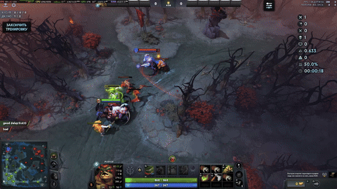
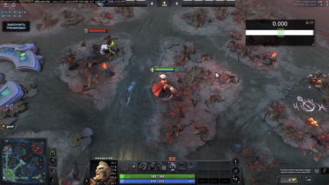
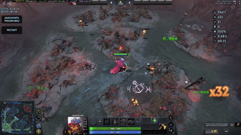

# training polygon

Practice tool for Dota 2. Last-hitting, dodging, timing, aim — the boring
mechanics you grind alone so you don't grief your team later.

[Steam Workshop](https://steamcommunity.com/sharedfiles/filedetails/?id=813598504) · 1M+ subscribers · single player


<p align="center">
  
  
  
</p>

## modes

- **last-hit training** — lane practice with real creep equilibrium, any hero
- **dodge** — skillshots fly at you, you move
- **timing** — reaction / cast-window drills
- **aim** — click the thing before it disappears
- **dream coil escape** — manta/eul's/frame-perfect escape practice

plus the legacy exercises (eul's, manta, invoker combos, skillshot, glimpse,
armlet toggling) that shipped in the legacy version.


## how to play

Subscribe on the workshop and launch from the arcade. If the lobby won't start
(Steam being Steam), open the console and:

```
dota_launch_custom_game 813598504 template_map
```

`dota` instead of `template_map` loads the WIP map. If it says UPDATE but
won't update: uninstall, then install again.

## building / contributing

Windows + Dota 2 Workshop Tools. Layout mirrors the Dota addon structure:
`game/` for compiled addon files, `content/` for UI sources (Panorama
XML/JS/CSS). Server logic is Lua (VScript), modes live in
`scripts/vscripts/gamemodes/`.

See [AGENTS.md](AGENTS.md) for the full layout tour and [CONTRIBUTING.md](CONTRIBUTING.md)
for setup. Bug reports and suggestions go in the workshop discussions.

## support

If the map helped your cs go from 30 to 60, you can tip me here:

[patreon](https://www.patreon.com/c/c0mb1ne) [boosty](https://boosty.to/combine) 

## license

MIT. Do whatever, just don't remove the license.
